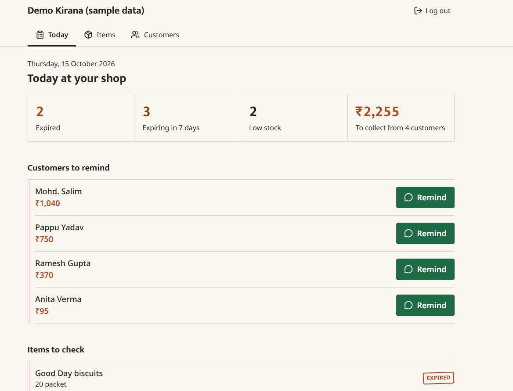
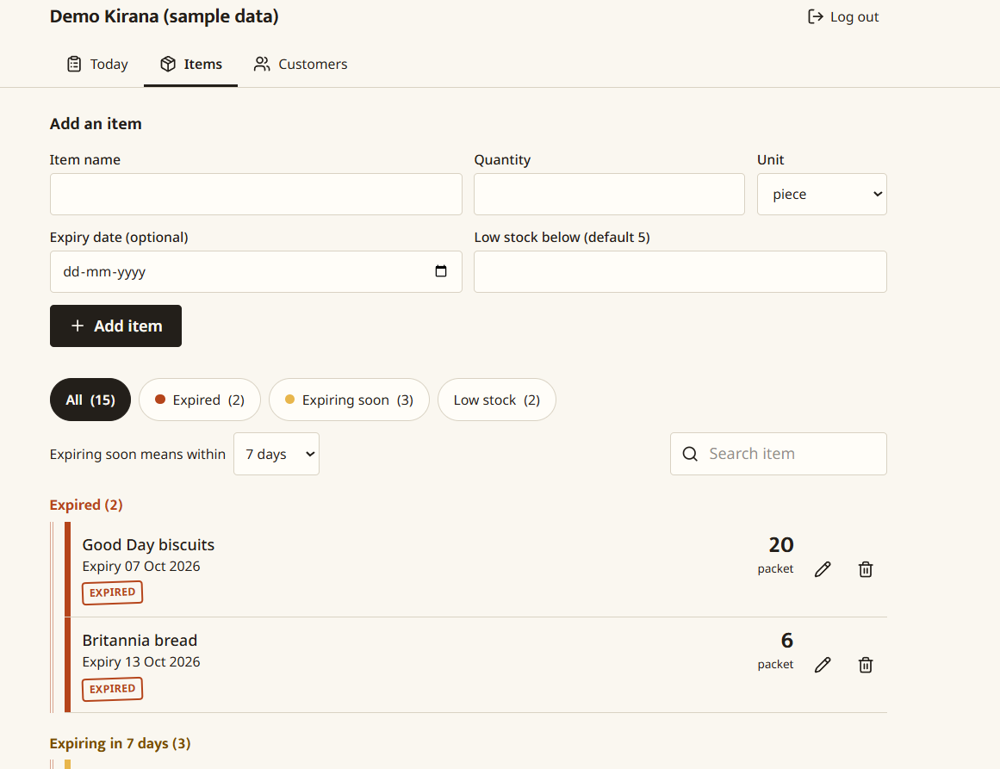
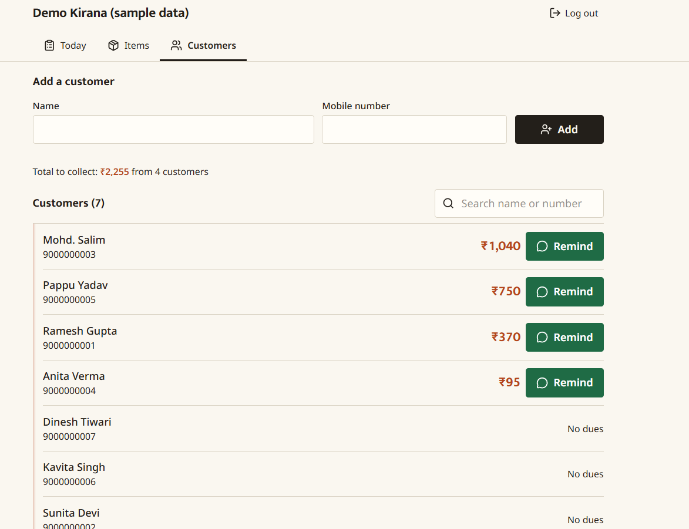

# KhataStock

A web app for small kirana shops. It keeps a list of the items in the shop with their quantity and expiry date, and it keeps the udhaar (credit) ledger of every customer.

Live: https://YOUR-APP-NAME.onrender.com
Demo login: `demo@example.com` / `demo1234`

The demo shop has made-up data and the phone numbers in it are fake. The site is on Render's free plan, so if nobody has opened it for 15 minutes the first load takes around a minute while the server wakes up.

<!-- Add a link to the demo video here once it is recorded -->

## Why I made this

Small shops usually write udhaar in a notebook and check expiry dates by looking at the packets. A page gets lost, a name is spelt two ways, a packet of biscuits stays on the shelf past its date and nobody notices.

I wanted something that works on a cheap phone at the counter, so the shopkeeper can write an item or an entry in a few taps and see who owes what without adding anything up.

<!-- After talking to shopkeepers, write here what they actually said: how they track udhaar today, what goes wrong, what they asked for. Remove this comment. -->

## What it does

You sign up with a shop name, email and password. Each shop only ever sees its own data.

**Items.** Add an item with quantity, unit and an optional expiry date. The list is split into expired, expiring soon, and everything else. "Soon" is 7 days by default and can be changed to 3, 15 or 30. Items below their low-stock limit get a tag too.

**Customers and udhaar.** Add a customer with a mobile number. Inside a customer you add an entry, either udhaar given or payment received. The customer's page looks like a page of a khata book: date, amount given, amount received, and what was still due after that entry.

**Today page.** The first screen. It shows how many items are expired, how many expire soon, how many are low, and the total money to collect. Tapping a number opens the matching list.

**Reminders.** Customers who owe money have a Remind button. It opens WhatsApp with the message already typed ("Namaste Ramesh ji, aapka Rs 450 udhaar baaki hai. - shop name") and the shopkeeper taps send.

## Choices I made

*Money is stored in paise as whole numbers.* Adding 0.1 and 0.2 in JavaScript does not give 0.3, and I did not want a customer's balance to be off by a paisa.

*A balance is never saved.* Every time it is needed, it is calculated from that customer's entries (given minus received) with a MongoDB aggregation. So if the shopkeeper deletes a wrong entry the balance is right again without anything else to fix. The running "Baaki" column in the khata table is worked out backwards from the current balance, so it stays correct even though the page loads only the latest 200 entries.

*Deleting an entry really deletes it.* A proper accounting ledger would never delete, it would add a reverse entry. I thought about doing that, but a shopkeeper who made a typing mistake will not understand a "reversal" row. The cost is that there is no history of what was changed.

*Reminders are a WhatsApp link, not automatic messages.* Sending messages by itself needs a paid SMS or WhatsApp Business service, and for SMS in India the sender also has to be registered (DLT). That was too much for this project. The link costs nothing and the shopkeeper still sends the message himself.

*One server for everything.* In production the Express app also serves the built React files, so there is one URL, one deploy and no CORS setup.

## Stack

React 18 and Vite, Tailwind CSS 4, Node with Express, MongoDB with Mongoose, JWT for login, bcrypt for passwords, helmet and express-rate-limit.

## Running it on your machine

You need Node 18 or newer and a MongoDB, either installed locally or a free Atlas cluster.

```bash
cd server
cp .env.example .env     # fill in MONGO_URI and JWT_SECRET
npm install
npm run dev
```

In a second terminal:

```bash
cd client
npm install
npm run dev
```

Open http://localhost:5173. Vite forwards `/api` calls to the server on port 5000.

To fill the app with demo data, run `npm run seed` inside `server`. Run it again any time to reset the demo shop. The expiry dates are set relative to the day you run it.

## Deploying

I use Render (a single web service) and MongoDB Atlas.

1. Push the repo to GitHub. Check that `.env` is not in it.
2. In Atlas, under Network Access, allow `0.0.0.0/0`. Render's free plan has no fixed IP.
3. On Render create a Web Service from the repo with these settings:
   - Build command: `npm run build`
   - Start command: `npm start`
   - Environment variables: `NODE_ENV=production`, `MONGO_URI`, `JWT_SECRET`
4. After it is live, run `npm run seed` from `server` on your own machine with the same `MONGO_URI` to create the demo shop.

## API

Everything except signup and login needs the header `Authorization: Bearer <token>`.

| Method | Path | What it does |
| --- | --- | --- |
| POST | `/api/auth/signup` | create a shop account |
| POST | `/api/auth/login` | log in |
| GET, POST | `/api/items` | list or add items |
| PUT, DELETE | `/api/items/:id` | edit or delete an item |
| GET, POST | `/api/customers` | list customers with balances, or add one |
| GET, PUT, DELETE | `/api/customers/:id` | one customer with their entries, edit, delete |
| POST | `/api/customers/:id/transactions` | add an entry (given or received) |
| DELETE | `/api/customers/:id/transactions/:txId` | delete an entry |
| GET | `/api/health` | check that the server is up |

## Folder layout

```
server/
  app.js          express app: middleware, routes, serves client in production
  server.js       connects to MongoDB and starts listening
  seed.js         demo shop
  models/         User, Item, Customer, Transaction
  routes/         auth, items, customers
  middleware/     JWT check
client/src/
  pages/          Login, Home (Today), Items, Customers, CustomerDetail
  api.js          fetch wrapper that adds the token
  money.js        paise to rupees
  dates.js        expiry and date helpers
  whatsapp.js     reminder message and link
```

## What is missing

- There are no automated tests. I checked things by hand.
- No password reset and no email check at signup. One login per shop, no staff accounts.
- Items and udhaar are separate. Giving udhaar does not reduce the stock of an item.
- The login token is kept in localStorage, which is simpler but easier to steal than an httpOnly cookie if the site ever had an XSS bug.
- Customer phone numbers are stored as plain text. Only Indian 10 digit mobile numbers are accepted.
- Lists are not paginated, and the khata table shows the latest 200 entries of a customer.
- It needs internet. Nothing is saved when offline.
- Only the login routes are rate limited.
- Mostly tested in Chrome.

## Screenshots




